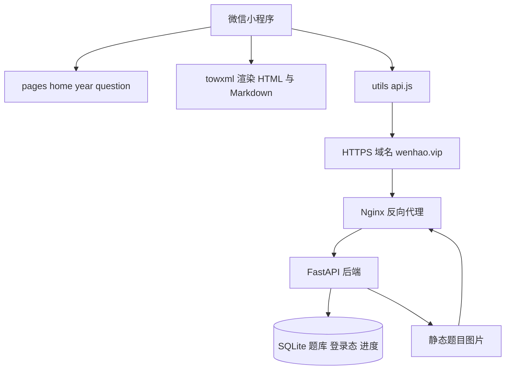

<plan_result>
<req>

## 用户要求

参考现有 `408刷题原型.html`，开发一个微信小程序版本。小程序使用用户提供的 appid；appsecret 和服务器登录凭据仅用于服务端配置，不写入代码仓库或文档。

## 产品概述

产品是 408 考研真题刷题工具，保留网页原型的核心流程：首页选择年份、年份页选择题号、答题页完成选择、查看答案与解析，并在服务端保存进度和登录态。

## 核心功能

- 首页展示年份列表、各年份做题进度和正确率。
- 年份页展示题目网格，支持进入指定题目和清空该年份进度。
- 答题页展示题干、选项、提交答案、两级提示、答错反馈、上一题/下一题。
- 解析区包含原解析、增强解析；增强解析需支持 Markdown、表格和 KaTeX 公式。
- 可视化解析页签在小程序中降级处理，避免依赖本地 iframe 页面。
- 使用 Python 自建服务端提供题库、登录和进度接口；全量题库不打包进小程序。
- 提供新手友好的架构文档、接口说明、部署步骤和 Mermaid 流程图。
</req>

<tech>

## Tech Stack Selection

- 小程序端：原生微信小程序，WXML + WXSS + JavaScript，配 `project.config.json`。
- 渲染：towxml 解析题干 HTML 与增强解析 Markdown，支持 KaTeX 公式；通过 npm 安装并在微信开发者工具中构建 npm。
- 服务端：Python + FastAPI + uvicorn，运行于 Docker 容器。
- 反向代理：Nginx 容器，负责 HTTPS、静态图片资源和 API 转发。
- 数据存储：SQLite 作为极简数据库，保存题库索引、登录态和答题进度；如后续扩展可平滑替换 PostgreSQL。
- 数据迁移：Python 脚本解析 `prototype-data/*.js` 中的 JSON 字面量，写入 SQLite，并抽取题干中的内联 SVG 资源为服务端图片。

## Implementation Approach

采用“小程序只放 UI 与 API 封装，服务端集中放题库与状态”的分层方案。原因是当前 `prototype-data/` 共约 32.8MB，远超小程序主包和总包限制，必须放到服务端按需读取。

核心决策：

- 保留网页原型的三视图结构，小程序的三个页面与原型一一对应，降低新手理解成本。
- 选用 towxml 而不是手写 rich-text 解析器，因为用户明确要求接近原型效果，且 rich-text 无法可靠渲染 KaTeX 公式。
- 后端采用 FastAPI，代码量少、接口类型清晰，适合“极简 Python 服务器”。
- 登录使用 `wx.login` 获取临时 code，后端调用微信 `code2session`，只用服务端环境变量保存 appsecret；小程序端不得出现 appsecret。
- 题库按年份和题号建立索引，列表接口只返回摘要，详情接口按题号返回，避免一次性传输全量题库。
- 题干中的 draw.io 内联 SVG 不在小程序端直接渲染，迁移时抽取为服务端图片资源，题库 HTML 中替换为图片链接。

性能与瓶颈：

- 年份列表和题目列表为 O(1) 到 O(n)，题量每年约 47，开销很小。
- 题目详情按 `(year, index)` 唯一索引查询，复杂度 O(1)。
- 进度读写按 `(openid, year, index)` 唯一索引查询，复杂度 O(1)。
- towxml 解析和 KaTeX 渲染是主要性能瓶颈；每道题只在进入题目时解析一次，页签切换复用已解析结果，避免重复解析。
- 图片资源使用 Nginx 静态服务，设置缓存头，避免重复下载大图。

## Implementation Notes

- 不修改现有 `408刷题原型.html`，只新建小程序、服务端、迁移脚本和文档。
- `appid` 可写入 `project.config.json`；appsecret、服务器 root 凭据不得写入任何文件，后端通过环境变量读取，样例文件只放变量名不放值。
- `wx.request` 要求 HTTPS 域名已备案并加入小程序后台 request 合法域名白名单；上线前需确认 `wenhao.vip` 的证书与白名单配置。
- 微信开发者工具需要执行“构建 npm”，否则 towxml 无法使用。
- 解析页中的可视化 iframe 指向本地 HTML，小程序内不能直接加载；降级为“请在网页版查看”的可选按钮或隐藏页签。
- 服务端接口需要校验参数范围，防止越权读取他人进度；所有进度接口必须以登录后得到的用户身份为准。
- 日志只记录请求路径、状态码、耗时和非敏感参数，不记录 appsecret、登录凭据或用户 openid 原文。

## Architecture Design



数据流：

- 小程序启动后先调用登录接口，后端返回自定义登录态 token。
- 首页读取年份列表和用户进度汇总。
- 年份页读取指定年份题目摘要。
- 答题页读取题目详情，使用 towxml 渲染题干、选项和解析。
- 提交答案、查看提示、查看解析时调用进度接口，服务端持久化状态。

## Directory Structure

```text
408-exam/
├── project.config.json                 # [NEW] 小程序项目配置。写入 appid、miniprogramRoot、编译设置；不写入 appsecret。
├── miniprogram/
│   ├── app.js                          # [NEW] 小程序入口。初始化登录态、全局配置和 API 基础地址。
│   ├── app.json                        # [NEW] 页面注册、窗口样式、tabBar 或自定义导航配置。
│   ├── app.wxss                        # [NEW] 全局样式。定义主题色、卡片、按钮、KaTeX 横向滚动等通用样式。
│   ├── sitemap.json                    # [NEW] 小程序索引用配置。
│   ├── package.json                    # [NEW] npm 依赖配置，声明 towxml，供开发者工具构建 npm。
│   ├── utils/
│   │   ├── api.js                      # [NEW] 统一请求封装。处理 HTTPS 请求、token 注入、错误提示和重试。
│   │   ├── auth.js                     # [NEW] 登录态封装。调用 wx.login，保存和读取服务端 token。
│   │   └── progress.js                 # [NEW] 进度格式化和本地临时状态工具，最终进度以服务端为准。
│   ├── components/
│   │   └── progress-bar/               # [NEW] 可复用进度条组件，用于年份页和首页统计。
│   ├── pages/
│   │   ├── home/                       # [NEW] 首页。展示年份列表、总进度、正确率和进入年份入口。
│   │   ├── year/                       # [NEW] 年份页。展示题目网格、年度统计、清空进度入口。
│   │   └── question/                   # [NEW] 答题页。题干、选项、提交、提示、解析页签和翻页。
│   └── assets/
│       └── icons/                      # [NEW] 小程序本地图标资源，避免使用在线-icons依赖。
├── server/
│   ├── Dockerfile                      # [NEW] Python 后端镜像。安装 FastAPI、uvicorn、数据库依赖。
│   ├── requirements.txt                # [NEW] Python 依赖清单。
│   ├── app/
│   │   ├── main.py                     # [NEW] FastAPI 入口。注册路由、异常处理和健康检查。
│   │   ├── config.py                   # [NEW] 读取环境变量，包括 WX_APPID、WX_APPSECRET、数据库路径。
│   │   ├── db.py                       # [NEW] SQLite 连接、表结构、索引和事务封装。
│   │   ├── auth.py                     # [NEW] code2session、自定义 token 签发和用户身份解析。
│   │   └── routers/
│   │       ├── questions.py            # [NEW] 年份列表、题目列表、题目详情接口。
│   │       └── progress.py             # [NEW] 提交答案、查看提示、查看解析和进度汇总接口。
│   ├── data/
│   │   └── questions.db                # [NEW/生成] 迁移脚本生成的 SQLite 数据库，不提交敏感信息。
│   └── static/
│       └── questions/                  # [NEW/生成] 从内联 SVG 转换出的题目图片资源。
├── scripts/
│   ├── import_prototype_data.py        # [NEW] 解析 prototype-data 下的 JS 赋值文件，写入 SQLite。
│   ├── extract_svg_assets.py           # [NEW] 抽取题干 HTML 中的内联 SVG，转换或保存为静态图片。
│   └── check_import.py                 # [NEW] 校验题库数量、年份覆盖、题号唯一性和图片引用。
├── docker-compose.yml                  # [NEW] 编排 nginx 与 Python 后端容器，声明环境变量来源。
├── nginx/
│   ├── nginx.conf                      # [NEW] HTTPS、静态资源和 API 反向代理配置。
│   └── conf.d/
│       └── p408.conf                   # [NEW] wenhao.vip 的 server 块和证书路径占位配置。
├── env.example                         # [NEW] 环境变量样例，只包含 WX_APPID、WX_APPSECRET 等变量名，不含值。
├── docs/
│   ├── miniprogram-architecture.md     # [NEW] 新手友好架构说明，含 Mermaid 图和目录解释。
│   ├── api.md                          # [NEW] 后端接口文档，逐个解释请求参数、返回值和错误码。
│   ├── deployment.md                   # [NEW] Docker、Nginx、HTTPS、小程序白名单和构建 npm 步骤。
│   ├── plans/
│   │   └── 2026-11-23-wechat-miniprogram.md # [NEW] 实施设计文档，记录本计划与偏差日志。
│   └── components/
│       ├── towxml.md                   # [NEW] towxml 接入与样式覆盖详解，面向新手逐项解释。
│       └── question-page.md            # [NEW] 答题页组件结构、数据流和交互说明。
└── README.md                           # [NEW] 快速启动、开发预览、后端部署和验收清单。
```

## Key Code Structures

关键接口以文字约定，避免实现阶段随意变更：

- 登录接口：小程序提交 `code`，后端返回自定义 token 和过期时间。
- 年份列表接口：返回年份、题数、已做题数、正确数。
- 题目列表接口：按年份返回题目摘要和索引。
- 题目详情接口：按年份和题号返回题干、选项、答案、原解析、增强 Markdown、提示、错误选项反馈和图片资源链接。
- 进度接口：按用户身份和题号保存 choice、correct、viewed、hintLevel、更新时间；汇总接口按年份返回统计。
- 所有接口统一返回结构：成功时包含 `code=0` 和 `data`，失败时包含非零 `code` 和可读 `message`。
</tech>

<design framework="Miniprogram" component="">
<description>

## 设计风格

延续网页原型的移动端卡片式结构，但按微信小程序习惯适配为更紧凑的 750rpx 设计基准。整体使用清爽的蓝紫色学习工具风格，保留白色卡片、柔和阴影、圆角按钮和清晰的题目层级。

## 页面规划

### 首页：年份选择

- 顶部品牌栏：展示“408 真题刷题”标题和简短说明。
- 总览卡片：展示累计已做、累计正确、正确率。
- 年份列表：每年一张卡片，显示年份、题数、进度条和正确率。
- 底部说明：展示数据更新说明和登录状态提示。

### 年份页：题目网格

- 顶部导航栏：返回首页，展示年份和题目总数。
- 年度统计卡：展示该年份完成度、正确率和剩余题数。
- 题目网格：按题号排列，颜色区分未做、正确、错误、已看解析。
- 操作区：提供“清空本年进度”按钮。
- 底部提示：说明颜色含义和继续刷题入口。

### 答题页：做题与解析

- 顶部题号栏：返回年份页，展示年份、题号、当前位置。
- 题干卡片：使用 towxml 展示题干文字、公式和题目图片。
- 选项区：单选卡片，提交后显示正确、错误和锁定状态。
- 操作区：提交答案、提示、查看答案与解析。
- 解析页签：原解析、增强解析；可视化解析降级为外部查看提示。
- 底部翻页：上一题和下一题按钮。

## 交互与反馈

按钮点击有轻微缩放反馈；题目状态用颜色区分；表格和长公式使用横向滚动；解析页签切换时先降低透明度再更新内容，保持原原型的操作节奏。
</description>
<style_keywords>
<keyword>卡片式布局</keyword>
<keyword>清爽蓝紫</keyword>
<keyword>移动端优先</keyword>
<keyword>柔和阴影</keyword>
<keyword>学习工具</keyword>
</style_keywords>
<font_system fontFamily="PingFang SC">
<heading size="36rpx" weight="700"></heading>
<subheading size="30rpx" weight="600"></subheading>
<body size="28rpx" weight="400"></body>
</font_system>
<color_system>
<primary_colors>
<color>#4F6AF6</color>
<color>#6F86FF</color>
<color="#EEF1FF</color>
</primary_colors>
<background_colors>
<color>#F4F6FB</color>
<color>#FFFFFF</color>
</background_colors>
<text_colors>
<color>#1C2333</color>
<color>#6B7280</color>
</text_colors>
<functional_colors>
<color>#16A34A</color>
<color>#E04343</color>
<color>#F5A524</color>
</functional_colors>
</color_system>
</design>

<extensions>

## Agent Extensions

### MCP

- **context7**
- Purpose: 查询 towxml、FastAPI 和微信小程序相关的最新文档与示例。
- Expected outcome: 确认 towxml 构建方式、FastAPI 路由写法和登录接口实现细节，减少版本误用。

### SubAgent

- **code-explorer**
- Purpose: 梳理原型页面交互、数据字段和题库文件结构。
- Expected outcome: 产出准确的文件清单、字段映射和页面流程，指导迁移和页面实现。
- **code-reviewer**
- Purpose: 在联调完成后审查安全、健壮性和上下文冲突。
- Expected outcome: 发现密钥泄露、接口越权、异常处理缺失等问题，并在验收前修复。
</extensions>

<todolist>
<item id="inspect-prototype" deps="">使用[subagent:code-explorer]梳理原型交互与数据字段</item>
<item id="scaffold-miniprogram" deps="inspect-prototype">创建小程序骨架与三页面路由</item>
<item id="migrate-data" deps="inspect-prototype">编写迁移脚本导入题库与图片</item>
<item id="build-backend" deps="migrate-data">使用[mcp:context7]实现Python后端接口与部署配置</item>
<item id="implement-pages" deps="scaffold-miniprogram">实现三页面交互与进度提交</item>
<item id="integrate-towxml" deps="implement-pages">接入towxml渲染题干与增强解析</item>
<item id="verify-review" deps="build-backend,integrate-towxml">使用[subagent:code-reviewer]联调验收与审查</item>
</todolist>
</plan_result>