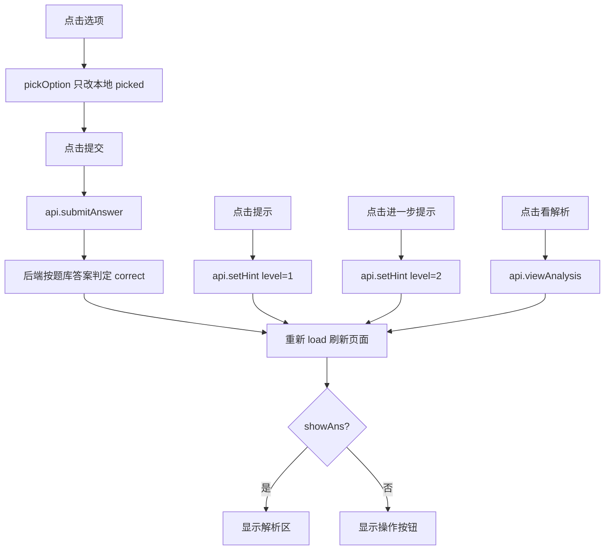

# 答题页详解（新手版）

答题页 `miniprogram/pages/question/` 是三个页面里最复杂的一个。这里按「页面状态 → 用户操作 → 数据请求」的顺序解释。

## 1. 页面状态从哪里来

进入页面时，`onLoad` 读取 URL 参数：

```
/pages/question/question?year=2009&index=2
```

`onShow` 每次显示页面都会调用 `load()`，从后端取题目详情和当前用户进度。

`load()` 用后端返回的 `progress` 派生四个关键状态：

| 状态 | 计算方式 | 影响 |
|---|---|---|
| `submitted` | `progress.choice` 是否存在 | 选项是否锁定、是否显示提交按钮 |
| `showAns` | `progress.viewed` 是否为真 | 是否显示解析区 |
| `hintLevel` | `progress.hintLevel` | 显示一级还是二级提示 |
| `picked` | `progress.choice` | 哪个选项高亮 |

这样设计的好处：刷新页面、重新进入题目，状态都能从服务端恢复，不依赖本地临时数据。

## 2. 用户操作与接口对应



## 3. 解析页签

`load()` 根据题目详情构造 `tabs` 数组：

- 一定有「原解析」和「增强解析」。
- 只有后端返回 `hasVisual=true` 时才有「可视化解析」。

`switchTab` 只改 `activeTab`，WXML 用 `wx:if` 显示对应内容。

三个页签的数据来源：

| 页签 | 数据 |
|---|---|
| 原解析 | 知识点 chips、`answerHtml`（非选择题）、`analysisHtml`、统计行 |
| 增强解析 | `enhanced.md`，由 towxml 以 `'md'` 模式解析，支持表格与公式 |
| 可视化解析 | 仅提示文字：小程序不支持 iframe，请在网页版查看 |

## 4. 错误选项反馈

`enhanced.wof` 结构：

```json
{ "A": { "title": "...", "reason": "...", "trap": "..." } }
```

只有「已提交 && 选错 && wof 里有该选项」时才显示卡片，和网页原型行为一致。

## 5. 翻页

后端详情接口返回 `prevIndex` / `nextIndex`，由 SQL 按题号相邻查询得到。页面用 `wx.redirectTo` 跳到同一页面组件的新参数，避免页面栈无限增长。

## 6. 常见问题排查

| 现象 | 检查点 |
|---|---|
| 页面一直“正在加载” | 后端是否启动、域名白名单、token 是否过期 |
| 公式显示成源码 `$$...$$` | 是否构建 npm、towxml 的 `parse(..., 'md')` 是否用对 |
| 选项点不动 | `submitted` 是否为 true（提交后锁定是正常行为） |
| 进度刷新后丢失 | 是否调用了对应接口、token 是否指向同一用户 |
