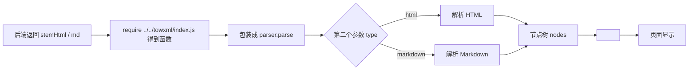
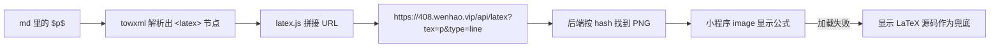

# towxml 接入详解（新手版）

towxml 是一个把 HTML/Markdown 转成微信小程序 WXML 节点的工具。我们用它来显示题干、选项、原解析和增强解析，因为它能识别 LaTeX 公式语法（`$...$` 和 `$$...$$`），而小程序自带的 `rich-text` 不能。

**注意**：towxml 本身并不在小程序里运行 KaTeX。它的公式插件会把 LaTeX 转成 `<latex>` 节点，再由 `latex` 组件去请求一张公式图片来显示。现在这个图片来自我们自己的服务器 `https://408.wenhao.vip/api/latex?tex=...&type=...`，不再是第三方 HTTP 服务。详见 `docs/plans/2026-11-26-miniprogram-katex-selfhosted.md`。

## 1. 为什么直接用本地目录，而不是「构建 npm」

早期版本尝试过 `package.json` 声明依赖 + 开发者工具「构建 npm」的方式，但行不通，原因有两个：

1. `package.json` 写的 `towxml@^4.0.0` 在 npm 官方源上不存在（最高只有 `3.0.6`），`npm install` 直接失败，根本没有 `node_modules`，也就无从「构建 npm」。
2. towxml 3.0.6 包内部的 `decode.json` 用绝对路径 `/towxml/decode` 引用子组件。这说明作者期望你把整包放在 `miniprogram/towxml/`（与 `pages` 同级）。如果硬塞进 `miniprogram_npm/towxml/`，这些绝对路径会指向不存在的目录，公式、表格、图片都渲染不出来。

所以现在的做法很简单：**把 towxml 整包放在 `miniprogram/towxml/`，不需要 npm，也不需要构建**。打开项目就能编译。

目录里几个关键文件：

| 文件 | 作用 |
|---|---|
| `index.js` | 解析器入口：**导出的是一个函数**，调用它把 HTML/Markdown 变成节点树。它不是小程序组件。 |
| `towxml.wxml/js/json/wxss` | **真正的组件**，页面里 `<towxml nodes="{{...}}" />` 用的就是它。 |
| `decode.json` | 组件内部用 `/towxml/...` 引用公式、表格、图片等子组件，所以整包必须放在 `towxml/` 目录。 |
| `style/main.wxss` | 基础样式，`app.wxss` 顶部引入。 |

## 2. 数据是怎样变成页面的



## 3. 代码里的三个关键点

### 3.1 require 与包装

`miniprogram/pages/question/question.js` 顶部：

```js
let towxmlParser = null;
function getParser() {
  if (towxmlParser) return towxmlParser;
  const toWxml = require('../../towxml/index.js');
  towxmlParser = { parse: (str, type) => toWxml(str, type) };
  return towxmlParser;
}
```

逐行解释：

- `let towxmlParser = null;` —— 缓存变量。第一次调用时加载，之后直接返回，避免重复 `require`。
- `require('../../towxml/index.js')` —— 从 `pages/question/` 往上两级回到 `miniprogram/`，再进 `towxml/`，拿到解析函数。
- `towxmlParser = { parse: (str, type) => toWxml(str, type) };` —— **关键**。towxml 3.x 的 `index.js` 直接 `module.exports = 函数`，没有 `.parse` 方法。这里包一层，让后面代码可以照旧写 `parser.parse(...)`，不用改 5 处调用。
  - `str`：要解析的 HTML 或 Markdown 字符串。
  - `type`：字符串 `'html'` 或 `'markdown'`，决定用哪套解析规则。
  - 返回值：解析后的节点树（`nodes`），交给组件渲染。

### 3.2 parse 的第二个参数

只接受两种值：

- `'html'`：题干、选项、答案、原解析本来就是 HTML。
- `'markdown'`：增强解析是 Markdown，里面有 `$$...$$` 公式和表格。

**注意**：不要写 `'md'`。3.x 遇到不认识的类型会直接抛 `Invalid type`。

第三个参数是配置项（例如主题），本项目使用默认值。

### 3.3 页面组件声明

`miniprogram/pages/question/question.json`：

```json
{
  "usingComponents": {
    "towxml": "/towxml/towxml"
  }
}
```

这里的路径要写**组件文件** `towxml`，不是解析器 `index`。以 `/` 开头表示从 `miniprogram/` 根目录算起。

## 4. 页面里的五处调用

`question.js` 的 `load()` 中：

| 字段 | 调用 | 用途 |
|---|---|---|
| `stemNodes` | `parse(q.stemHtml, 'html')` | 题干 |
| `optionNodes` | 对每个 `option.html` 调用 `parse(..., 'html')` | 选项 |
| `answerNodes` | `parse(q.answerHtml, 'html')` | 非选择题答案 |
| `originalNodes` | `parse(q.analysisHtml, 'html')` | 原解析 |
| `enhancedNodes` | `parse(enhanced.md, 'markdown')` | 增强解析（表格 + KaTeX） |

这些节点在 `load()` 时一次解析完，切换解析页签只改 `activeTab`，不重复解析，避免卡顿。

## 5. 样式覆盖

`miniprogram/app.wxss` 顶部引入 towxml 基础样式：

```css
@import "./towxml/style/main.wxss";
```

后面自定义的 `.towxml` 规则负责：

- `table` 最小宽度 720rpx，外层 `.scroll-x` 可横向滚动。
- `img / svg` 最大宽度 100%，不超出卡片。
- `.katex / .katex-display` 最大宽度 100%，长公式横向滚动。

## 6. 公式图片是怎么来的（新手版）



几个关键点：

- **为什么要预生成图片**：KaTeX 的输出是 HTML + CSS，依赖浏览器和字体文件。小程序的 `<image>` 只能加载图片，所以开发时用 Playwright 驱动本机 Edge，把 KaTeX 排版结果截图成 PNG，放在 `server/static/formulas/`。
- **为什么要先扫描一遍**：`scripts/build_formula_images.js` 用**和小程序完全相同的 towxml 解析器**提取所有公式（共 7962 处、去重后 4294 个）。只有口径完全一致，小程序发来的请求才能命中图片。
- **hash 是什么**：每个公式的源码经过归一化（统一换行、去首尾空格）后算 MD5，再拼上类型（`line` 行内 / `block` 独立成行）。同名同类型的公式只生成一张图，自动去重。
- **为什么要 type 参数**：同一个公式在行内和独立成行时排版不同（例如求和符号的上下标位置），所以要分别生成、分别请求。
- **图片为什么清楚**：截图按 3 倍像素生成，`latex.js` 里用 `16 * 3 = 48` 换算回 `em`，在高分屏上也不会糊。
- **断网或公式缺失怎么办**：`latex.js` 监听 `binderror`，失败时不再留空白，而是把 LaTeX 源码直接显示出来（红色小字），读者至少能看懂公式内容。

官方组件文档虽提到 KaTeX，但那是靠第三方在线服务实现的。我们改成自建服务，是因为那个服务是 HTTP 协议，微信小程序会拦截，导致公式位置变成空白。

## 7. 已知限制

1. 题干里从 draw.io 抽出的 SVG 是静态文件；少数安卓机型可能显示不完整，必要时改成 PNG。
2. 增强解析 Markdown 中如果有图片，`question.js` 会把 `/data/enhanced-analysis/assets/...` 映射到服务端 `/static/questions/...`。若服务端确实没有该 SVG，图片组件会降级显示"示意图暂缺"，不再留下空白占位。
3. 可视化解析原本是 iframe，小程序不能直接加载，页面里降级为提示文字。
4. 整包放在 `miniprogram/towxml/`，不要挪动目录名，否则 `decode.json` 里的 `/towxml/...` 绝对路径会全部失效。
5. 若 towxml 版本升级导致 API 变化，优先检查 `index.js` 的导出形式、`parse` 的类型参数、组件路径 `/towxml/towxml` 三处。
