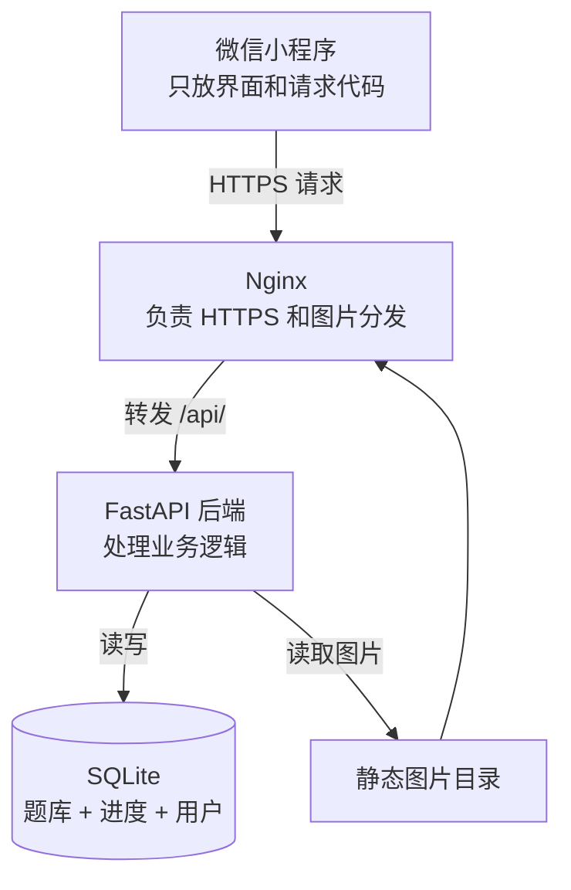
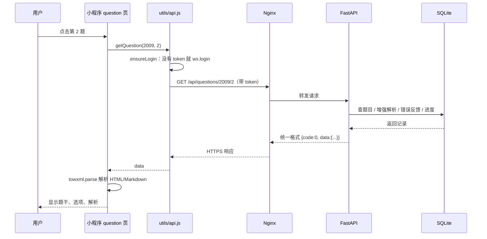
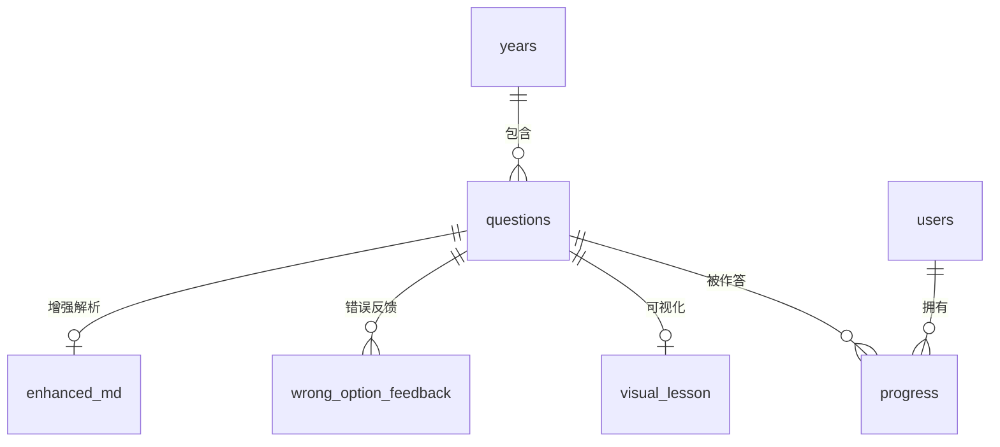

# 408 刷题小程序架构说明（新手版）

这篇文档面向第一次接触小程序的同学。目标是解释「为什么分成小程序和服务器两边」「数据怎么流动」「每个目录是干什么的」。看不懂某个词没关系，先记住整体图，再对照目录逐个看。

## 1. 为什么要分成两端

网页原型 `408刷题原型.html` 是「一个 HTML 文件 + 一堆 JS 数据文件」，双击就能打开。但微信小程序有硬限制：

- 小程序主包最多 2MB，总包最多 20MB。
- 你的 `prototype-data/` 有 37 个文件、约 **32.8MB**，根本塞不进小程序。

所以采用「小程序只放界面，服务器放全部题库和进度」的方案：

对应到现实世界：小程序像「点餐的手机 App」，Nginx 像「前台接待」，FastAPI 像「厨房」，SQLite 像「冰箱（存放所有原料和订单记录）」。

## 2. 一次答题的数据流

以打开 2009 年第 2 题为例：

要点：

1. token 是登录后服务端签发的「通行证」，后续每个请求都带上；token 里不含密码，也不含 openid 原文。
2. 题干 HTML 和增强解析 Markdown 都交给 towxml 解析，因为小程序的 `rich-text` 不能可靠渲染 KaTeX 公式。
3. 进度不在小程序本地保存，`wx.setStorageSync` 只存 token；进度统一由服务端保存，换设备也能继续。

## 3. 目录对照表

| 目录/文件 | 作用 | 类比 |
|---|---|---|
| `408刷题原型.html` | 原始网页原型，本次不改 | 设计图纸 |
| `project.config.json` | 小程序项目配置，含 appid | 项目身份证 |
| `miniprogram/` | 小程序代码 | 手机 App 本身 |
| `miniprogram/pages/home` | 首页：年份列表 | 第一屏 |
| `miniprogram/pages/year` | 年份页：题目网格 | 第二屏 |
| `miniprogram/pages/question` | 答题页 | 第三屏 |
| `miniprogram/utils/api.js` | 统一请求封装 | 跑腿的信使 |
| `miniprogram/utils/auth.js` | 登录与 token 管理 | 门卡管理器 |
| `miniprogram/utils/progress.js` | 进度状态换算 | 统计员 |
| `miniprogram/components/progress-bar` | 可复用进度条 | 通用零件 |
| `miniprogram/towxml/` | towxml 3.0.6 整包，本地渲染 HTML/Markdown，无需构建 npm | 翻译工具箱 |
| `server/app/main.py` | 后端入口，注册接口 | 前台总机 |
| `server/app/config.py` | 读取环境变量（密钥只在这里出现） | 保险柜说明书 |
| `server/app/db.py` | 数据库连接与用户/进度表 | 仓库管理员 |
| `server/app/auth.py` | 微信登录与 token 校验 | 门卫 |
| `server/app/routers/questions.py` | 题库接口 | 题目窗口 |
| `server/app/routers/progress.py` | 进度接口 | 记账窗口 |
| `server/data/questions.db` | 迁移生成的 SQLite 数据库 | 冰箱 |
| `server/static/questions/` | 从题干抽出的 SVG 图片 | 图片柜 |
| `scripts/import_prototype_data.py` | 把原型数据导入数据库 | 搬货工人 |
| `scripts/check_import.py` | 校验搬货结果 | 质检员 |
| `scripts/smoke_test_backend.py` | 后端接口冒烟测试 | 试运行 |
| `nginx/` | HTTPS 与反向代理配置 | 前台与门面 |
| `docker-compose.yml` | 一条命令启动多个容器 | 集装箱清单 |
| `env.example` | 环境变量样例（只有变量名，没有值） | 空白表格 |

## 4. 数据库表关系

- `years`：18 年的索引信息（题数、总分、学科分布）。
- `questions`：846 道题的题干、选项、解析、提示、统计。
- `enhanced_md`：每题的增强解析 Markdown。
- `wrong_option_feedback`：每题每个错误选项的反馈。
- `users` / `progress`：用户与答题进度，按 `user_id + 年份 + 题号` 唯一。

## 5. 安全边界

- `appid` 可以写进 `project.config.json`，它不是密钥。
- 内部使用版本**不做登录鉴权**：每台设备本地生成一个随机 `deviceId`，通过请求头 `X-Device-Id` 传给后端，后端直接用它作为用户标识。
- 不再使用 `appsecret`、`wx.login`、`code2session`、token；小程序和服务器上都没有这些密钥项。
- 进度按设备隔离：不同设备 ID 的记录互不影响；同一设备卸载重装后若本地 ID 丢失，进度视为新设备。
- 日志只记录路径、状态码、耗时，不记录设备 ID 原文。

## 6. 已知限制

1. 可视化解析原本是 iframe 加载本地 HTML，小程序不能直接加载；答题页保留页签但显示「请在网页版查看」。
2. draw.io 导出的内联 SVG 已抽成静态文件并去掉庞大的 `content` 元数据；部分安卓机型对 SVG 支持有限，如需兼容可再转 PNG。
3. 增强解析中原本就有图片链接，原型的手写渲染器不支持图片；towxml 支持 Markdown 图片，但迁移时只改写了题干里的图片路径，增强解析里的图片路径需要在后续按需补充映射。
