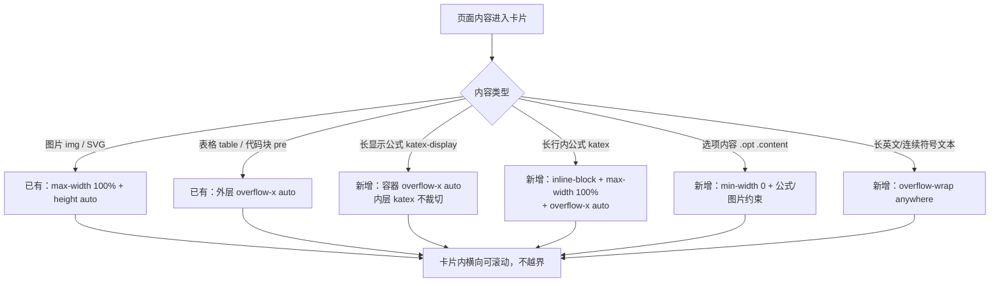

# 统一检查并修复页面内容溢出问题（2026-11-23）

> 状态：已完成实施并通过浏览器验证（2026-11-23）。
> 关联计划：`2026-11-23-fix-enhanced-markdown-render.md`（已完成的表格、公式块、SVG 修复）

## 1. 目的与背景

用户反馈 `2009 年第 2 题` 增强解析中「对应栈深度变化为」下方的长公式再次超出卡片右边缘，并要求对「以上的问题做统一检查并修复」。这里理解为：**对页面所有内容类型做一次溢出排查，并一次性补齐约束规则**，而不只是修这一条公式。

已完成的只读排查（未修改任何代码）：

1. **DOM 实测（520px 窗口）**：第 2 题增强解析 `#tabContent` 可视宽 452px、实际内容宽 531px；扫描出 24 个元素右边缘越过卡片。超长元素是 KaTeX 生成的 `<span class="katex-display">` 内的 `<semantics>/<mrow>`，宽 504px，右边缘 1144px，而卡片右边缘 884px。
2. **DOM 实测（360px 窄屏）**：第 2 题可视宽 292px、内容宽 531px；第 2016 年第 44 题的**行内公式**有 19 个元素越过卡片右边缘。
3. **数据扫描**：共检查 2538 个 `stemHtml` / `analysisHtml` / `answerHtml` 字段，其中 221 个含固定宽度 HTML（题干 138、原解析 74、选项 9）；另有约 25 处长度超过 60 字符的行内公式候选。
4. 现有 CSS 只约束了 ``、`<svg>`、`<pre>`、`<table>`，**没有约束 KaTeX 生成的 `<span class="katex">` / `<span class="katex-display">`**；选项区 `.opt` 是 flex 布局，`.opt .content` 缺少 `min-width: 0`，长内容会撑破容器。

根因：数学公式（尤其 KaTeX 默认 `white-space: nowrap`）不会被浏览器自动折行；之前只处理了图片/表格，遗漏了公式和选项内容。

## 2. 期望结果

- 在 520px 和 360px 两种窗口宽度下，题干、原解析、增强解析、选项、错误反馈中的内容都不再越过卡片右边缘。
- 过长公式改为**容器内横向滚动**，公式本身不折行（避免破坏数学语义），内容与图片保持可读。
- 已修复的表格、SVG、行内公式渲染不回退。
- 不联网、不新增依赖、不改题库数据。

## 3. 核心逻辑



关键点：

- 显示公式：给 `.katex-display` 自身加滚动条，并把它的内层 `.katex` 恢复为 `display:block; overflow:visible`，避免出现双层滚动条或内层被裁切。
- 行内公式：把 `.katex` 变成 `inline-block` 并限制最大宽度，超长时横向滚动；用 `vertical-align: middle` 保持与文字基线对齐。
- 选项：`.opt .content { min-width: 0; }` 允许 flex 子项收缩，公式/图片沿用同样的宽度约束。
- 文本：`overflow-wrap: anywhere` 只影响普通文字和代码，不影响 KaTeX 内部排版。

## 4. 实现方案

只改一个文件：`F:/part/post-graduate/408-exam/408刷题原型.html` 的 `<style>` 区块（现有第 142–150 行附近）。**不改 `mdToHtml()`、不改 `tex()`、不改数据文件。**

### 4.1 新增/调整的 CSS

```css
.stem { overflow-wrap: anywhere; }
.stem .katex-display { max-width: 100%; overflow-x: auto; overflow-y: hidden; padding-bottom: 2px; }
.stem .katex { display: inline-block; max-width: 100%; overflow-x: auto; overflow-y: hidden; vertical-align: middle; }
.stem .katex-display .katex { display: block; overflow: visible; }
.opt .content { min-width: 0; overflow-wrap: anywhere; }
.opt .content img, .opt .content svg { max-width: 100%; height: auto; }
.opt .content .katex { display: inline-block; max-width: 100%; overflow-x: auto; overflow-y: hidden; vertical-align: middle; }
```

保留已生效的 `.stem img/svg/table/pre`、`.svg-wrapper`、`.table-wrap` 规则。

### 4.2 不改动的内容

- `mdToHtml()` / `tex()` / 路由 / 答题进度逻辑。
- `prototype-data/*.js` 数据文件（原文正确，属于显示层问题）。
- KaTeX 本地文件与引入方式。

## 5. 涉及代码

| 位置 | 当前内容 | 改动 |
|---|---|---|
| `408刷题原型.html` 第 142–150 行 `<style>` | 仅约束 img/svg/table/pre | 新增 7 条 CSS（公式 4 条、选项 3 条），`.stem` 增加 `overflow-wrap` |
| `408刷题原型.html` 第 264–331 行 `mdToHtml()` | 表格与公式块已修复 | 不改 |
| `408刷题原型.html` 第 334–345 行 `tex()` | KaTeX 自动渲染 | 不改 |
| `prototype-data/*.js` | 题库内容 | 不改 |

## 6. 潜在风险

1. 公式出现横向滚动条：这是刻意取舍——不折行以保证数学正确，用户可左右滑动查看超长公式。
2. `overflow-wrap: anywhere` 可能让超长英文单词在中间断行；比溢出卡片更可接受，中文不受影响。
3. 行内 `.katex` 改为 `inline-block` 会造成细微基线变化；`vertical-align: middle` 已用于抵消。
4. `.opt .content { min-width: 0 }` 会让选项文字区变窄、可能多折一行；左侧字母圆圈 `.label` 仍是 `flex: none`，不会变形。

## 7. 验收标准

在浏览器中（520px 与 360px 两种窗口宽度）验证：

1. 第 2009 年第 2 题增强解析：显示公式「栈深度变化」所在区域不再越过卡片；`#tabContent.scrollWidth <= #tabContent.clientWidth`；扫描无 `getBoundingClientRect().right > 卡片 right + 1` 的元素。
2. 第 2016 年第 44 题增强解析（长行内公式）：360px 下无元素越过卡片右边缘。
3. 第 2009 年第 47 题题干：SVG 仍在卡片内，表格仍可横向滚动。
4. 第 2011 年第 17 题选项（含 KaTeX）：选项内容不撑破卡片，字母圆圈不变形。
5. 第 2009 年第 1 题增强解析：标题、列表、行内公式渲染正常，无回归。
6. 无新增 lint 错误；验证产生的临时文件、服务器、浏览器会话已清理。

## 实施偏差与变更日志

### 2026-11-23 实施结果

- 原计划：新增 7 条 CSS 约束（4 条公式/文本、3 条选项），不改 JS 与数据。
- 实际实现：与计划一致，仅修改 `408刷题原型.html` 的 `<style>` 区块。
- 验证结果：
  - 520px 与 360px 下，第 2009/2、2009/47、2009/1、2016/44、2011/17 题的 `#tabContent.scrollWidth` 均等于 `clientWidth`，页面全局 `documentElement.scrollWidth` 等于窗口宽度。
  - 按「祖先存在可滚动容器且容器未越界」重新判定后，两种宽度下真实溢出元素数均为 0；超长公式由 `.katex-display` 横向滚动承载（client 452 / scroll 531，容器右边缘 866 < 卡片 884）。
  - 第 2009/2 题表格 14 行、3 处公式；第 2009/47 题大图仍在卡片内；第 2011/17 题选项内容右边缘远小于选项右边缘。
  - 无新增 lint 错误，控制台仅有既有的 `favicon.ico 404`。
- 变更原因：无偏差。
