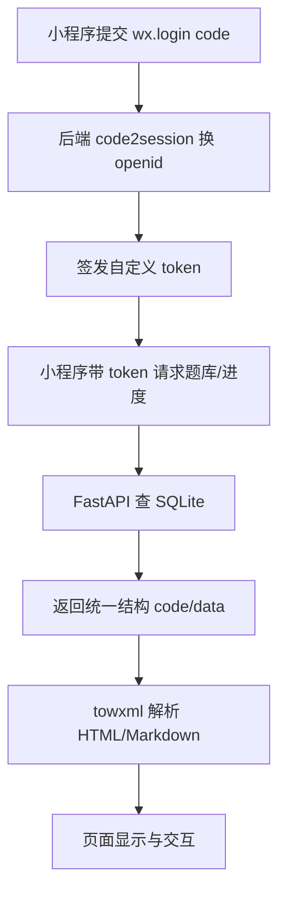

# 微信小程序迁移实施设计（2026-11-23）

> 状态：实施中。本文件记录计划与实际实现的对应关系，以及偏差日志。

## 1. 目的与背景

参考 `408刷题原型.html`，开发微信小程序版本。由于 `prototype-data/` 约 32.8MB，超过小程序包体限制，题库必须放服务端。用户选择 towxml 渲染 Markdown + KaTeX，选择 Python 自建后端并用 SQLite 保存进度与登录态。

## 2. 期望结果

- 小程序三页面：首页年份列表、年份题目网格、答题页。
- 完整保留提交答案、两级提示、答错反馈、查看答案、原解析/增强解析页签、翻页。
- 增强解析支持表格与 KaTeX 公式；可视化解析降级。
- 服务端保存进度与登录态；不打包题库；不泄露密钥。

## 3. 核心逻辑

## 4. 实现方案

- 小程序原生框架，目录 `miniprogram/`，`app.json` 注册三页面。
- `utils/api.js` 统一请求，`utils/auth.js` 管理 token，`utils/progress.js` 换算状态。
- 答题页 `load()` 一次解析所有 towxml 节点，页签切换复用。
- Python FastAPI 后端，SQLite 存题库与进度；Nginx 处理 HTTPS 与静态图片。
- `scripts/import_prototype_data.py` 从原型 JS 迁移数据，抽取 SVG 为静态图片。

## 5. 涉及代码

新增：
- `project.config.json`
- `miniprogram/**`
- `server/**`
- `scripts/import_prototype_data.py`、`check_import.py`、`smoke_test_backend.py`
- `docker-compose.yml`、`nginx/**`、`env.example`
- `docs/miniprogram-architecture.md`、`api.md`、`deployment.md`、`components/**`

不修改：`408刷题原型.html`、`prototype-data/**`。

## 6. 风险与处理

| 风险 | 处理 |
|---|---|
| 密钥泄露 | appsecret/root 密码只走环境变量，不写文件 |
| 包体超限 | 题库放服务端，小程序只放 UI |
| towxml 未构建 | 文档强调开发者工具执行「构建 npm」 |
| SVG 兼容 | 去掉 draw.io content 元数据；必要时转 PNG |
| 可视化 iframe | 小程序降级为提示文字 |

## 7. 验收标准

- `python scripts/check_import.py` 通过：18 年、846 题、图片无缺失。
- 后端冒烟测试通过：健康、年份、题目、详情、答题/提示/解析/清空接口正常。
- 小程序可编译、可预览；三页面流程走通；增强解析公式与表格正常。
- 仓库中无明文密钥。

## 8. 实施偏差与变更日志

### 2026-11-23 偏差记录

1. **Context7 文档查询失败**：环境报 `fetch failed`，未能在线核对 towxml / FastAPI 最新版本用法。处理方式：采用已知稳定写法，并在 `docs/components/towxml.md` 中标注版本变化时检查 `parse` 参数与组件路径。
2. **requirements.txt 版本调整**：原写 `uvicorn[standard]==0.34.0`，当前软件源最高 0.33.0，安装失败。改为范围约束 `>=0.30,<0.34`，实测安装与冒烟测试通过。
3. **迁移筛选变量笔误**：`enhanced-*.js` 筛选初版误用外层变量 `fn`，导致增强解析 0 条；已修正为 `f`，现为 846 条。
4. **图片路径校验**：原型自带 `/static/questions/2023/38-official-diagram.png` 指向 html 目录而非迁移输出目录，校验脚本增加双路径回退，现图片引用 246 个、缺失 0。
5. **code-reviewer 审查后修复**：移除 `TOKEN_SECRET` 弱默认值（漏配直接拒绝启动）；年份页改用后端 `hasOptions` 判断选择题，避免摘要无 `options` 时崩溃；迁移改为只重建题库表、保留用户进度；SVG content 正则兼容双引号；校验脚本同时检查 `/image/`；80 端口补 ACME 目录与 HTTPS 跳转；SQLite 增加 busy_timeout 与原子创建用户；提示接口返回实际层级并修复无历史时变量未定义；token 过期检查与 401 单次重试；错误反馈限定答错时显示；冒烟测试改用临时库；文档修正构建 npm 与验证命令。
