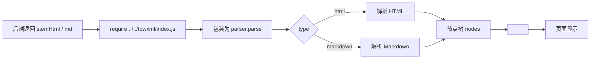

# 修复 towxml 组件路径导致的编译报错（2026-11-26）

## 1. 目的与背景

微信开发者工具打开项目报错：

> `pages/question/question.json: ["usingComponents"]["towxml"]: "/miniprogram_npm/towxml/index"，在 .../miniprogram_npm/towxml/index 路径下未找到组件`

调研（下载 `towxml@3.0.6` npm 包并逐文件核对）发现是**五个错误叠加**，只改其中一处仍会继续报错：

1. **依赖版本不存在**：`miniprogram/package.json` 声明 `towxml@^4.0.0`，但 npm 官方源最高版本是 `3.0.6`。实测 `npm install` 报 `ETARGET`，因此没有 `node_modules`，「构建 npm」根本无法生成 `miniprogram_npm`，这是当前直接报错的原因。
2. **组件名写错**：towxml 3.0.6 的组件入口是 `towxml.wxml/js/json/wxss`；`index.js` 只是解析器函数入口，**不是小程序组件**。即使 `miniprogram_npm` 生成成功，`/miniprogram_npm/towxml/index` 仍然找不到组件。
3. **接入方式不适用**：包内 `decode.json` 用绝对路径 `/towxml/decode`、`/towxml/latex/latex` 引用子组件，说明官方期望把整包放在 `miniprogram/towxml/`（与 `pages` 同级）。若用 npm 构建到 `miniprogram_npm/towxml/`，这些绝对路径会指向不存在的 `miniprogram/towxml/`，公式、表格、图片渲染会连带失败。
4. **parse 类型写错**：`question.js` 用 `parser.parse(..., 'md')`，而 3.x 的 `index.js` 只接受 `'html'` 和 `'markdown'`，`'md'` 会抛 `Invalid type`。
5. **模块调用方式写错**：3.x 的 `index.js` 直接 `module.exports = (str, type, option) => {...}`，导出的是**函数本身**，没有 `.parse` 方法。现有 `parser.parse(...)` 会抛 `parser.parse is not a function`。

## 2. 期望结果

- 微信开发者工具打开项目不再报 `usingComponents` 组件找不到。
- `miniprogram/towxml/` 包含完整 towxml 3.0.6 文件，项目**不再依赖「构建 npm」**步骤（对新手更友好，也绕开 npm 版本不存在的死结）。
- 答题页题干、选项、原解析、增强解析（Markdown 表格 + KaTeX 公式）正常渲染。
- 相关文档与代码注释同步为新路径，全项目无 `miniprogram_npm` 残留引用。

## 3. 核心逻辑

## 4. 实现方案

1. 从 npm 下载 `towxml@3.0.6`，将包内文件放到 `miniprogram/towxml/`（与 `pages` 同级）。包内 `decode.json` 的 `/towxml/...` 绝对路径在新位置可正确解析。
2. `miniprogram/pages/question/question.json`：`usingComponents.towxml` 由 `/miniprogram_npm/towxml/index` 改为 `/towxml/towxml`。
3. `miniprogram/pages/question/question.js`：
   - `require('../../miniprogram_npm/towxml/index.js')` 改为 `require('../../towxml/index.js')`；
   - 在 `getParser()` 内把导出的函数包装成 `{ parse: (str, type) => fn(str, type) }`，保持现有 5 处 `parser.parse(...)` 调用不变，改动最小；
   - `parser.parse(..., 'md')` 改为 `'markdown'`；
   - 注释由「构建 npm 后生成」改为「本地 towxml 目录」。
4. `miniprogram/app.wxss`：`@import "./miniprogram_npm/towxml/style/main.wxss"` 改为 `@import "./towxml/style/main.wxss"`。
5. `miniprogram/package.json`：删除 `dependencies.towxml`（保留文件，说明无需 npm）；同步修改 `miniprogram/app.js` 中「构建 npm」注释。
6. 文档同步：`docs/components/towxml.md` 改为本地目录接入说明；`docs/plans/2026-11-23-wechat-miniprogram.md` 偏差日志追加「npm 构建方案作废」一条。

## 5. 涉及代码

**修改：**

- `miniprogram/pages/question/question.json`
- `miniprogram/pages/question/question.js`
- `miniprogram/app.wxss`
- `miniprogram/package.json`
- `miniprogram/app.js`
- `docs/components/towxml.md`
- `docs/plans/2026-11-23-wechat-miniprogram.md`

**新增：**

- `miniprogram/towxml/**`（从 `towxml@3.0.6` npm 包解压，约 60 个文件，含 `index.js`、`towxml.*`、`decode.*`、`style/`、`parse/`、`latex/` 等）

**删除：**

- 无。调研阶段的临时 `towxml-3.0.6.tgz` 与 `package/` 目录已清理。

## 6. 潜在风险

| 风险 | 处理 |
|---|---|
| KaTeX 公式渲染失败 | README 明确 3.0+ 支持 LaTex；包内自带 `latex/` 组件，`/towxml/latex/latex` 在新位置可正确解析 |
| 包体积增大 | towxml 约数百 KB，远低于小程序 2MB 限制；题库仍在服务端，不打包题库 |
| `fs-extra` 依赖 | 仅 towxml 构建脚本使用，运行时不需要；本地放置后不引入该依赖 |
| 旧路径残留 | 执行后全项目搜索 `miniprogram_npm`，除历史文档说明外应为 0 处 |
| npm 源版本差异 | 已实测官方源最高 `3.0.6`，锁定为该版本，不再写 `^4.0.0` |

## 7. 验收标准

- 微信开发者工具打开项目，编译无 `usingComponents` 报错。
- 答题页题干、选项、原解析可见；切到「增强解析」页签能看到表格与 KaTeX 公式。
- `miniprogram/` 下搜索 `miniprogram_npm` 无结果。
- 文档路径与实际代码一致。

## 8. 待用户确认

以上方案是否执行？确认后我将按第 4 节逐项修改，并在完成后做一次全局自我审查（需求对齐 / 健壮性 / 上下文冲突）。

## 9. 实施偏差与变更日志

### 2026-11-26 实施记录

1. **towxml 文件数量估算偏差**：原计划写「约 60 个文件」，实际解压 `towxml@3.0.6` 得到 88 个文件（含 `parse/highlight/languages/` 多语言高亮、`parse/parse2/entities/maps/` 实体映射表等）。原因：估算时未逐项统计包内文件。不影响方案，全部文件均已放置到 `miniprogram/towxml/`。
2. **验收方式补充**：原计划验收靠微信开发者工具编译。当前环境无开发者工具，改用 Node 直接调用包装后的解析器做等价验证：HTML/Markdown 均返回合法节点树，Markdown 表格与 `$$...$$` 公式均能解析；并校验 `decode.json` 中 7 个 `/towxml/...` 子组件引用全部指向存在的文件；`miniprogram/` 下 `miniprogram_npm` 残留 0 处，lint 0 错误。开发者工具的最终编译仍需用户打开项目确认。
3. **无其他偏差**：第 4 节 6 项修改全部按计划执行，未改动计划外文件。
