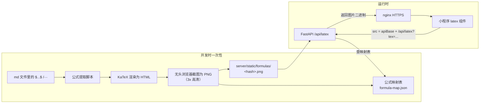

# 小程序端自建 KaTeX 公式渲染（消除解析页空白）

## 1. 目的与背景

### 1.1 用户问题

2022 年第 3 题增强解析页出现大量空白（`$p$`、`$q$`、`$$...$$` 位置）。截图如下现象：

- 行内公式 `$p$` 变成文字之间的空缝；
- 块公式 `$$...$$` 变成一整行空白；
- 解析示意图 SVG 也显示为空白。

### 1.2 已确认的根因（调研结论，非猜测）

空白不是数据丢失，而是**渲染管线断了**：

1. Markdown 源数据完整：`html/data/enhanced-analysis/2022/03.md` 第 5、9、13-17 行都含有 LaTeX 源码。
2. 小程序用 towxml 解析，`latex.js` 插件（第 144-150 行）把公式转成 `<latex>` 节点。
3. `latex` 组件（`miniprogram/towxml/latex/latex.js:27-33`）把公式内容编码进 URL，请求第三方服务 `http://towxml.vvadd.com/?tex`（配置在 `miniprogram/towxml/config.js:5-7`）。
4. 该服务是 **HTTP**（微信小程序只放行 HTTPS），域名未加入 `downloadFile` 合法域名，图片请求必然失败。
5. `latex.wxml:1` 的 `<image>` 初始宽高为 `0em × 0em`，只有 `bindload` 成功才赋值（第 37-51 行）；加载失败 → 尺寸永远为 0 → 只剩 margin → 视觉上是空白。
6. 小程序端没有内置 KaTeX，没有任何兜底。网页版 `408刷题原型.html:7-9` 用本地 `html/vendor/katex/` 渲染正常，所以网页版不受影响。

另外，示意图 SVG 映射到 `https://408.wenhao.vip/static/questions/2022_3_analysis_1.svg`，实测返回 **404**，属于同一类"外部资源缺失导致空白"，本次一并修复（见第 4 节步骤 5）。

### 1.3 用户已确认的决策

- **范围**：只修小程序端，网页版不动。
- **内置方式**：放在自己的服务器，用 408.wenhao.vip 的 HTTPS 接口提供公式图片，稳定、简单、可缓存；接受"没网时公式不显示"。

### 1.4 概念澄清（避免误解）

- **LaTeX**：公式的书写语法，如 `$p$`、`\frac{a}{b}`、`\text{左子树}`。题目数据里存的就是这种文本。
- **KaTeX**：把 LaTeX 文本排版成好看公式的渲染引擎。网页版本地已有 KaTeX。
- 我们要做的是：**把 KaTeX 渲染能力放到自己的服务器上，产出图片给小程序显示**，不再依赖 `towxml.vvadd.com`。

---

## 2. 期望结果

| 编号 | 验收项 | 期望 |
|---|---|---|
| R1 | 2022 年第 3 题增强解析 | 所有 `$p$`、`$q$`、`$T$`、`$$...$$` 正常显示为数学公式，无空白 |
| R2 | 全库同类问题 | 所有含公式的题目（约 510 份 md）都能正常显示，不是只修一题 |
| R3 | 示意图 | `图解：四种关系示意` 的图片正常显示（或明确降级为文字提示，不留空白占位） |
| R4 | 网页版 | 完全不受影响，沿用本地 KaTeX |
| R5 | 依赖 | 不再请求任何第三方 `http://` 公式服务，全部走 `https://408.wenhao.vip` |
| R6 | 小程序包体 | 不增大（公式渲染不放进小程序包） |

---

## 3. 核心逻辑

### 3.1 总体架构（Mermaid）

### 3.2 为什么 KaTeX 需要"截图"这一步

KaTeX 的 `renderToString()` 输出的是 **HTML + CSS**（`...`），依赖浏览器和字体文件才能显示，它本身**不直接产出图片**。要得到小程序 `<image>` 能加载的图片，有两条路：

| 方案 | 做法 | 优点 | 缺点 |
|---|---|---|---|
| A（本次采用） | KaTeX 渲染 HTML → 无头浏览器截图 → PNG | 严格用 KaTeX，中文 `\text{左子树}` 能正确显示，小程序兼容性最好 | 需开发时跑一次截图脚本；PNG 比 SVG 略大 |
| B（备选） | MathJax 直接输出 SVG | 纯矢量、体积小、无需浏览器 | 不是 KaTeX；中文 `\text{}` 在 SVG 中依赖系统字体，小程序显示有风险 |

本项目解析里有 `\text{左子树}` 这类中文公式，方案 B 的中文渲染有不确定性，因此选方案 A。

### 3.3 公式 hash 与缓存

- 每个公式的 LaTeX 源码用稳定 hash（如 MD5）生成文件名，例如 `a1b2c3d4.png`。
- 相同公式只生成一次，自动去重，避免重复文件。
- 行内公式与块公式共用同一张 PNG，显示尺寸由小程序端 `class="h2w__latex--line/block"` 控制（沿用现有 WXSS）。
- 图片按 hash 命名后可永久缓存，nginx 已有 `Cache-Control: max-age=86400`，后续再调 CSS 不需要重新生成图片。

### 3.4 兼容性兜底（不写旧方案兼容，但有容错）

- `/api/latex` 收到未知公式（映射表查不到）时：返回 404，而不是返回一张空白图；小程序端 `latex` 组件的 `binderror` 事件负责显示 LaTeX 原文（如 `$p$`），让用户至少能看到源码，而不是空白。
- 这是对"异常路径"的处理，不是对旧方案的兼容分支。

---

## 4. 实现方案（步骤）

### 步骤 1：新增公式提取与渲染脚本

- 文件：`scripts/build_formula_images.py`（Python，负责扫描 md、提取公式、去重、写出待渲染清单）
- 文件：`scripts/render_formulas.js`（Node.js，用 KaTeX + Playwright 读取清单，批量截图为 PNG）
- 输入：`html/data/enhanced-analysis/**/*.md`（全库约 510 份）
- 输出：
  - `server/static/formulas/<hash>.png`
  - `server/static/formulas/formula-map.json`（hash → 公式信息，用于服务端查询和调试）

### 步骤 2：服务端新增公式接口

- 文件：`server/app/routers/latex.py`（新增）
- 接口：`GET /api/latex?tex=<URL编码公式>&theme=light`
- 逻辑：
  1. 对 `tex` 做规范化（去首尾空白、统一换行）并算 hash；
  2. 查 `formula-map.json`，命中则返回对应 PNG（`media_type='image/png'`）；
  3. 未命中返回 404（小程序端走降级显示 LaTeX 源码）；
  4. 接口免登录认证（公式内容不敏感，`<image src>` 也无法携带 header）。
- 注册：`server/app/main.py` 增加 `app.include_router(latex.router)`。

### 步骤 3：小程序切换公式图片来源

- 文件：`miniprogram/towxml/config.js`
- 改动：`latex.api` 从 `http://towxml.vvadd.com/?tex` 改为 `https://408.wenhao.vip/api/latex?tex`（与现有 `latex.js` 第 30 行的 URL 拼接格式完全兼容，只需改这一行配置）。

### 步骤 4：小程序公式加载失败降级（异常路径）

- 文件：`miniprogram/towxml/latex/latex.js`、`latex.wxml`
- 改动：新增 `binderror` 处理，加载失败时把 `dataAttr.value`（URL 解码后的 LaTeX 源码）显示为文本，避免空白。
- 注意：不改变 towxml 的节点结构和现有 class，避免影响其它解析内容。

### 步骤 5：修复示意图 404（同类问题一并处理）

- 现状：`question.js:17-21` 把 md 图片映射到 `/static/questions/2022_3_analysis_1.svg`，服务器无此文件（实测 404）。
- 处理方案（需确认，因为涉及服务端数据）：
  - 选项 A：从 `html/data/enhanced-analysis/` 找出对应 SVG 源文件并同步到 `server/static/questions/`；
  - 选项 B：若源文件本就不存在，则让小程序在图片加载失败时隐藏图片区域并显示一行提示文字（如"示意图暂缺"），不留大块空白。
- 本次先做**选项 B 的容错**（纯前端，风险低）；选项 A 需要先确认源文件是否存在，不在本次改动范围，单独列给后续处理。

### 步骤 6：批量验证

- 写一个校验脚本，遍历所有含公式的 md，确认：
  - 公式提取数量与映射表条目数一致；
  - 所有 PNG 文件存在且非空；
  - 随机抽样 20 个公式通过 `/api/latex` 返回 200 + image/png。

---

## 5. 涉及代码

| 文件 | 操作 | 说明 |
|---|---|---|
| `scripts/build_formula_images.py` | 新增 | 扫描 md、提取公式、去重、生成待渲染清单 |
| `scripts/render_formulas.js` | 新增 | KaTeX + Playwright 批量截图为 PNG |
| `scripts/package.json` / `package-lock.json` | 新增 | 固定 `katex`、`playwright` 版本，保证可复现 |
| `server/static/formulas/*.png` | 新增（生成物） | 公式图片，提交到仓库供 Docker 镜像打包 |
| `server/static/formulas/formula-map.json` | 新增（生成物） | 映射表 |
| `server/app/routers/latex.py` | 新增 | 公式图片接口 |
| `server/app/main.py` | 修改 | 注册新路由（1 行） |
| `miniprogram/towxml/config.js` | 修改 | 公式服务地址改为自有 HTTPS（1 行） |
| `miniprogram/towxml/latex/latex.js` | 修改 | binderror 降级显示 LaTeX 源码 |
| `miniprogram/towxml/latex/latex.wxml` | 修改 | 降级文本渲染 |
| `miniprogram/towxml/img/img.js` | 修改 | 图片加载失败降级（隐藏/提示，消除示意图空白） |
| `docs/components/towxml.md` | 修改 | 同步修正文档中"KaTeX 可正常渲染"的错误描述，说明新管线 |

**不改动**：`408刷题原型.html`、`html/vendor/katex/`、`html/data/enhanced-analysis/**/*.md`（网页版与源数据保持原样）。

---

## 6. 潜在风险

| 风险 | 说明 | 应对 |
|---|---|---|
| 中文公式渲染 | `\text{左子树}` 等中文依赖系统字体，截图环境缺中文字体会显示方块 | 截图脚本使用 Playwright Chromium + 明确指定 `font-family: "Microsoft YaHei", sans-serif`；渲染后人工抽查中文公式 PNG |
| PNG 数量与仓库体积 | 约几百到上千个公式，PNG 总量可能 5-15MB | 先生成清单统计数量；合理则提交，过大则改为按年份分包/按需生成 |
| Playwright 浏览器依赖 | 开发机需安装 Chromium（约 150MB） | 只在开发时安装一次；运行时容器不需要，小程序包不增大 |
| 小程序 HTTPS 域名 | `408.wenhao.vip` 已用于 API，需确认 `downloadFile` 合法域名已配置 | 已在用（API 请求走此域名），若图片仍失败需在小程序后台补 `downloadFile` 域名 |
| 首次加载速度 | 公式图片需联网加载 | 按 hash 缓存 + nginx 强缓存；加载期间保留 LaTeX 源码占位，避免空白 |

---

## 7. 验收标准

- [ ] 2022 年第 3 题增强解析：所有公式显示正常，无空白缝隙/空白行。
- [ ] 全库扫描：含公式的 md 文件（约 510 份）中出现的公式全部在映射表中。
- [ ] `GET https://408.wenhao.vip/api/latex?tex=p` 返回 200、Content-Type 为 `image/png`，图片内容可见字符 `p`。
- [ ] 未知公式返回 404，小程序端显示 LaTeX 原文而非空白。
- [ ] 示意图加载失败时显示提示文字，不再留大块空白。
- [ ] 网页版打开 2022 年第 3 题，公式显示与改前一致（回归确认）。
- [ ] 小程序包体积无变化（公式图片不在包内）。
- [ ] 全局自我审查：需求对齐、异常路径覆盖、无上下文冲突，并输出审查结论。

---

## 实施偏差与变更日志

### 1. 提取脚本从 Python 正则改为 Node + towxml 解析器

- **原计划**：`scripts/build_formula_images.py` 用正则扫描 md 提取公式。
- **实际实现**：`scripts/build_formula_images.js` 直接调用小程序同款 towxml 解析器提取 `<latex>` 节点。
- **变更原因**：实测正则口径与 towxml 不一致——正则漏掉跨行行内公式（如 `$a \n\rightarrow c$`），且块公式截取内容不同。第一版用正则生成 4353 张图后，用真实解析器校验发现 19 个节点无法命中，会造成新的空白。改用同款解析器后，7962 个节点、去重 4294 个，校验 0 缺失。已删除旧 Python 脚本。

### 2. 图片总体积高于估算

- **原计划**：估算 5–15 MB。
- **实际实现**：4294 张 PNG，共约 22.5 MB。
- **变更原因**：3 倍像素截图 + 透明背景，中文公式较多导致单图偏大。为保证高分屏清晰度和中文正确性保留该尺寸；图片只在服务端，不进小程序包，不影响用户下载体积。

### 3. 服务端路由路径 bug 修复

- **原计划**：`FORMULA_DIR` 从 `routers/` 向上两级定位。
- **实际实现**：向上三级。
- **变更原因**：首次实现定位到 `server/app/static/formulas`（不存在），接口返回 503。测试时发现并修正为 `server/static/formulas`。

### 4. yuml 配置保持原样

- **原计划**：未涉及。
- **实际实现**：`config.js` 中 `yuml.api` 仍指向同一第三方 HTTP 服务。
- **变更原因**：全库搜索确认没有任何增强解析使用 yuml 语法，属于未启用的死配置；本次不扩大改动范围。如后续启用，需按同样方式自建服务。
